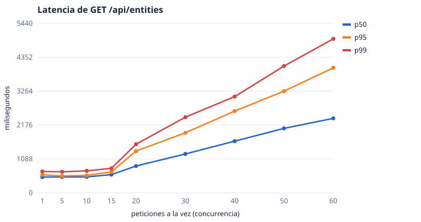
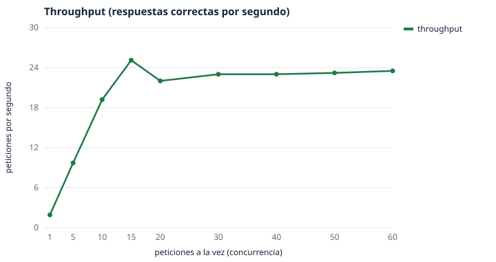
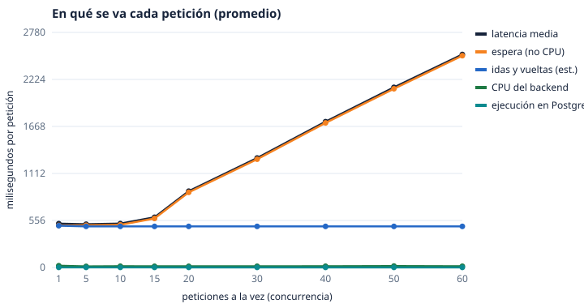
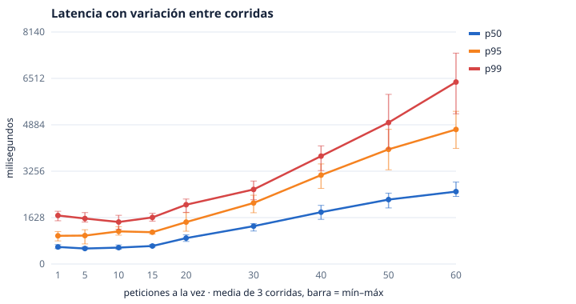
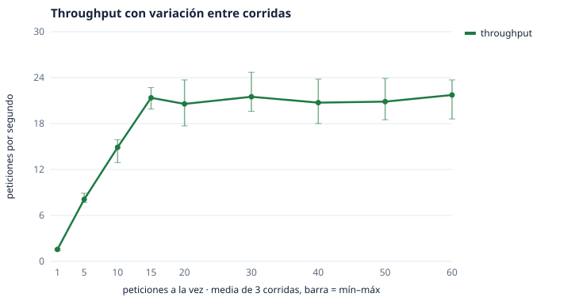
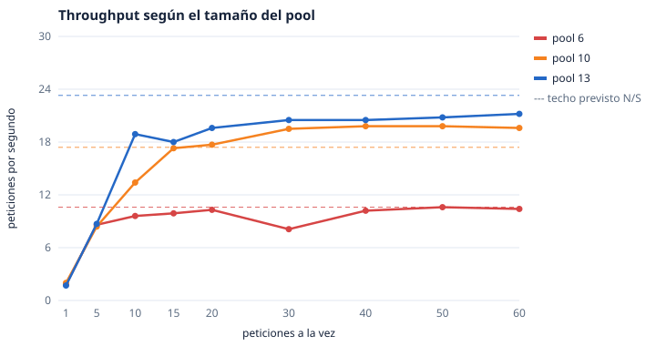
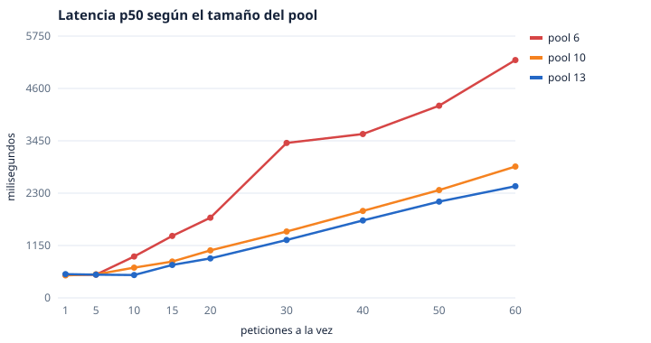
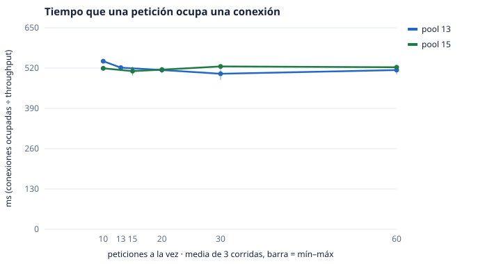
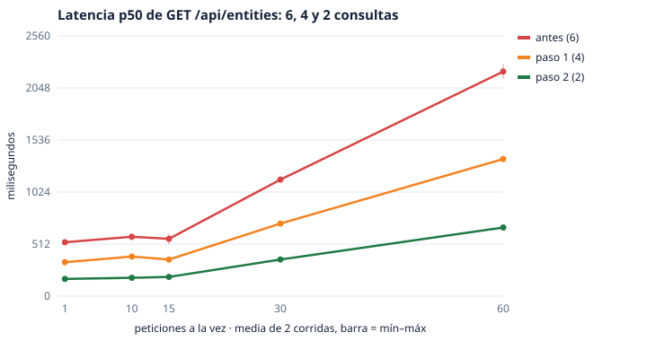
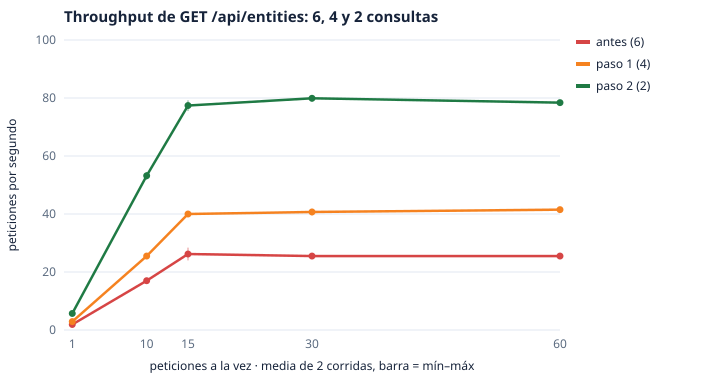

# Práctica 1 · Benchmark de `GET /api/entities`

## 1. Fecha, entorno y versión
- **Fecha:** 27 oct 2026, de 16:04 a 16:25 (hora de Colombia).
- **Código:** `empre_backend` en `98f40e8`, rama `main`, sin cambios locales en la aplicación.
- **Backend:** el local (`go run cmd/api/main.go`) en `localhost:8080`, en Windows con 12 núcleos lógicos.
  - Lo único distinto a un arranque normal: `ENABLE_PPROF=1` (para leer memoria y perfiles de CPU) y **`DB_MAX_OPEN_CONNS=13`, `DB_MAX_IDLE_CONNS=13`**. Lo normal son 15; ver hallazgo H1.
- **Base:** la PostgreSQL remota de desarrollo (Supabase), a través de su pooler en **modo sesión**.
  - Ida y vuelta medida con `SELECT 1`: p50 81 ms y p95 85 ms.
- **Cliente:** en la misma máquina que el backend. Es `bench.go` (biblioteca estándar, fuera del repositorio), con carga en lazo cerrado: cada trabajador manda una petición, espera la respuesta y manda la siguiente, sin pausa.
- **Autenticación:** no hace falta; la ruta es pública.

## 2. Método
- **Petición, siempre la misma:** `GET /api/entities?lat=11.2408&long=-74.2110&radius=5000&page=1&pageSize=20`. Devuelve 20 de 29 negocios, unos 8,9 KB. Es de solo lectura.
- **Niveles:** 1, 5, 10, 15, 20, 30, 40, 50 y 60 trabajadores a la vez.
  - **Calentamiento:** 8 s, que no cuentan.
  - **Medición:** 45 s.
  - **Pausa:** 10 s entre niveles.
  - **Repeticiones:** una corrida por nivel.
- **Qué se registró:**

| Medida | De dónde sale | Por petición o global |
|---|---|---|
| Latencia p50, p95 y p99, errores, timeouts (límite de 10 s) y throughput | `bench.go`, cada petición | por petición, vista por el cliente |
| Latencia en el servidor | log JSON del backend (`"ms"`) dentro de la ventana | por petición |
| CPU del backend | tiempo de CPU del proceso (`Get-Process`) antes y después, dividido entre las peticiones | **promedio** (contador del proceso) |
| Memoria reservada y objetos | `TotalAlloc` y `Mallocs` del runtime de Go (`/debug/pprof/heap`) antes y después | **promedio** |
| RAM | `WorkingSet` cada 2 s | del proceso |
| Consultas por petición | contador de GORM (`empre_db_queries_total`) antes y después | **promedio**; es fiable porque no hubo otro tráfico al backend |
| Esperas del pool | `sql.DBStats` (`empre_db_wait_*`) | **promedio** |
| Ejecución dentro de Postgres por tipo de consulta | `pg_stat_statements` antes y después, sumado por tipo | global de la base; vale porque no hubo otro tráfico (ver la sección 6) |
| Dónde se va la CPU | perfil `pprof` de 20 s con 1 y con 60 a la vez | muestreo |

## 3. Qué hace una petición
Lo que sigue se leyó en el código: el handler `EntityHandler.FindAll` → `EntityService.FindAll` → `EntityRepository.FindAll`.
- **Consultas: 6 por petición**, medidas con el contador de GORM en todos los niveles.
  1. `COUNT` con los filtros (incluido un `NOT EXISTS` sobre suscripciones).
  2. La página, con 3 JOIN (categoría, foto de perfil y portada).
  3. Precarga de fotos con su media.
  4. Precarga de subcategorías.
  5. Precarga de horarios.
  6. El resumen agrupado de reseñas.

  **Van una detrás de otra:** la petición usa una conexión a la vez.
- **En memoria:** firma URLs de S3 (perfil, portada y cada foto), con goroutines por negocio y por imagen, y arma el JSON.
- **Dentro de Postgres cada consulta tarda de 0,02 a 0,32 ms**, menos de 1 ms la petición entera (`pg_stat_statements`, ver el punto 7 de la sección 5). Cada ida y vuelta por la red cuesta unos 81 ms.

## 4. Resultados
| A la vez | Peticiones | Throughput (pet./s) | p50 | p95 | p99 | Máx. | Errores y timeouts | CPU por petición | Espera por petición | Consultas por petición | Espera de conexión al pool por petición |
|---:|---:|---:|---:|---:|---:|---:|---:|---:|---:|---:|---:|
| 1 | 87 | 1,9 | 505 ms | 579 | 685 | 685 | 0 | 20,8 ms | 498 ms | 6,1 | 0 |
| 5 | 442 | 9,7 | 509 | 541 | 674 | 685 | 0 | 12,9 | 499 | 6 | 0 |
| 10 | 874 | 19,2 | 510 | 559 | 704 | 1.116 | 0 | 14,9 | 504 | 6 | 0 |
| 15 | 1.145 | **25,1** | 584 | 672 | 786 | 1.262 | 0 | 14,0 | 580 | 6 | 77 ms |
| 20 | 1.004 | 22,0 | 860 | 1.339 | 1.559 | 1.823 | 0 | 13,9 | 889 | 6 | 315 ms |
| 30 | 1.055 | 23,0 | 1.247 | 1.927 | 2.428 | 3.254 | 0 | 14,4 | 1.280 | 6 | 731 ms |
| 40 | 1.060 | 23,0 | 1.658 | 2.623 | 3.088 | 3.843 | 0 | 14,6 | 1.710 | 6 | 1.159 ms |
| 50 | 1.071 | 23,2 | 2.069 | 3.263 | 4.069 | 4.713 | 0 | 16,9 | 2.114 | 6 | 1.570 ms |
| 60 | 1.093 | 23,5 | 2.390 | 4.012 | 4.942 | 5.508 | 0 | 14,5 | 2.505 | 6 | 1.969 ms |

**Recursos del backend (todo el proceso):**

| A la vez | CPU de la máquina | Núcleos usados | Memoria reservada por petición | Objetos por petición | Recolecciones de basura en 45 s | Heap en uso al final |
|---:|---:|---:|---:|---:|---:|---:|
| 1 | 0,3 % | 0,0 | 1.192 KB | 15.468 | 11 | 22,7 MB |
| 10 | 2,3 % | 0,3 | 1.152 KB | 15.332 | 106 | 24,6 MB |
| 15 | 2,9 % | 0,3 | 1.154 KB | 15.375 | 137 | 25,2 MB |
| 30 | 2,7 % | 0,3 | 1.161 KB | 15.594 | 109 | 27,7 MB |
| 60 | 2,8 % | 0,3 | 1.160 KB | 15.737 | 87 | 31,5 MB |

**Otros datos:**
- **RAM máxima:** 86 MB.
- **Hilos del sistema:** 22 como máximo.
- **Goroutines al final de cada nivel:** 11.
- **Errores HTTP, fallos de red y timeouts:** 0 en los 9 niveles.
- **La latencia del servidor coincide con la del cliente** (p50 503 ms contra 505 ms con 1 a la vez; 2.389 contra 2.390 con 60). La red entre el cliente y el backend es despreciable.
- **Ley de Little:** throughput × latencia media da 1,0 / 5 / 10 / 14,9 / 19,9 / 29,8 / 39,7 / 49,4 / 59,2 trabajadores, igual a la concurrencia aplicada. Eso indica que **el cliente no fue el límite** y que las cifras son consistentes entre sí.

**Gráficas:**

**Perfil de CPU con 60 a la vez (20 s):**
- **El total:** 6,75 s de CPU en 20 s, es decir 0,34 de un núcleo.
- **Dentro de la petición:** de 3,0 s de CPU, **unos 2,0 s son firmar URLs de S3**, en la cadena de middlewares del AWS SDK. Unos 0,8 s son pasar los resultados de las consultas a estructuras de Go (`scanIntoStruct`).
- **El resto:** es del runtime de Go (recolección de basura y planificador) y del propio perfilado.

## 5. Hechos observados
1. **Hasta 10 a la vez, la latencia no cambia:** p50 de unos 505–510 ms. El throughput crece en proporción a la concurrencia (1,9 → 19,2 pet./s).
2. **Entre 15 y 20 aparece un techo de unas 22–25 pet./s.** Desde ahí, duplicar la concurrencia casi no sube el throughput y la latencia crece en línea recta, unos 40 ms más por cada trabajador.
3. **Lo que crece es la espera, no el trabajo.** La CPU por petición queda fija en 13–17 ms y las consultas por petición en 6. La espera de conexión al pool pasa de 0 (con 10) a 77 ms (con 15) y a **1.969 ms** (con 60). Con 60, la espera del pool es el 79 % de la latencia media.
4. **El backend casi no usa la máquina:** a lo sumo 3 % de la CPU, 86 MB de RAM, y la memoria por petición es constante (~1,15 MB y ~15.500 objetos).
5. **Ninguna petición falló ni se pasó de tiempo.** La degradación es en latencia, no en errores.
6. **Con 1 a la vez, ~498 de 505 ms son espera fuera de la CPU.** Coincide con 6 consultas × 81 ms ≈ 486 ms de idas y vueltas.
7. **Postgres no se degrada con la concurrencia.** Por `pg_stat_statements` (sumando por tipo de consulta antes y después de cada nivel), cada petición ejecuta **exactamente 6 consultas**, una de cada tipo. Su ejecución total dentro de Postgres es de **0,76 a 0,86 ms por petición**, igual con 1 que con 60 a la vez:

   | Consulta | Llamadas por petición | Ejecución en Postgres por llamada (con 1 → con 60) | Filas por llamada |
   |---|---:|---:|---:|
   | `COUNT` de negocios con filtros | 1 | 0,113 → 0,102 ms | 1 |
   | Página de negocios (3 JOIN) | 1 | 0,318 → 0,285 ms | 20 |
   | Precarga de fotos y media | 1 | 0,098 → 0,087 ms | 13 |
   | Precarga de subcategorías (tabla puente)* | 1 | 0,026 → 0,021 ms | 0 |
   | Precarga de horarios | 1 | 0,234 → 0,209 ms | 140 |
   | Resumen de reseñas | 1 | 0,066 → 0,056 ms | 9 |

   \* Con 0 filas en la tabla puente, GORM no hace la segunda consulta de subcategorías. Por eso son 6 y no 7.

   **Corrección:** una primera versión de este informe decía que había «tráfico ajeno» de ~4.400 consultas por segundo. **Era un error de mi script de comparación:** cruzaba las filas por `queryid`, que puede repetirse porque la lectura no incluye el rol, y daba diferencias falsas. Las dos lecturas «sin carga» tomadas 30 s aparte son idénticas (143.081 llamadas en las dos). En `pg_stat_activity` solo aparecen el pooler (Supavisor) y los procesos propios de Supabase (PostgREST, exportador de métricas, pg_cron). No hay otro cliente.
8. **H1, el tope del pooler:** el pooler tiene un tope de **15 clientes para todo el proyecto**. Con la configuración normal del backend (15 conexiones precalentadas), un segundo cliente que entró por el pooler fue rechazado: `max clients reached in session mode` (ver la sección 6).

## 6. Límites de las mediciones
- **`pg_stat_statements` es de toda la base.** Sus diferencias valen para esta prueba solo porque no hubo otro tráfico (ver la corrección del punto 7 de la sección 5), y hay que **sumarlas por tipo**, no cruzarlas por `queryid`. Mide solo la ejecución dentro de Postgres: no incluye la red, el pooler ni la espera de conexión.
- **El tiempo de base de `Server-Timing` y de `empre_db_query_ms_total` está inflado.** El cronómetro de una consulta con `Preload` sigue abierto mientras corren sus precargas, que también se miden aparte, así que ese tiempo se cuenta dos veces. Por eso no se usó; sí se usó el **número** de consultas.
- **CPU, memoria y consultas por petición son promedios** de contadores del proceso. Valen porque no hubo otro tráfico al backend, pero no dan la distribución por petición.
- **La «espera»** se calcula como latencia media menos CPU media. Junta red a la base, espera del pool y planificación, y se separa con dos datos: la espera medida del pool y la estimación de 6 idas y vueltas × 81 ms.
- **Una sola corrida por nivel.** No hay intervalo de confianza. La red a Supabase varía entre corridas (lo vimos en 3.53 y 3.54).
- **Cliente y backend en la misma máquina** (12 núcleos). Aquí no limitó (Ley de Little, CPU por debajo del 3 %), pero no representa un despliegue real.
- **El pool se bajó a 13 conexiones** para dejar lugar a la sonda. Con 15, el techo esperado sería proporcionalmente más alto (ver H2).
- **El perfil de CPU dura 20 s** y es por muestreo.

## 7. Hipótesis (aparte de los hechos)
| # | Hipótesis | En qué se apoya | Qué la confirmaría o la descartaría |
|---|---|---|---|
| H1 | El pooler de Supabase en **modo sesión** (15 clientes en total) limita a todo el proyecto: el backend con 15 conexiones deja sin lugar a cualquier otro proceso (herramientas, una segunda instancia, un despliegue sin cortar el anterior). | El rechazo `max clients reached in session mode` cuando el backend tenía 15. | Revisar la configuración del pooler en Supabase (modo y tamaño); probar el modo transacción (puerto 6543) con `PrepareStmt` apagado; arrancar dos instancias del backend y ver si la segunda falla. |
| H2 | **El techo de ~23–25 pet./s lo pone el pool, no la CPU ni Postgres:** 13 conexiones / (6 consultas × ~85 ms) ≈ 25 pet./s. | El techo coincide con la cuenta. La espera del pool aparece justo al pasar de ~13 trabajadores. La CPU queda debajo del 3 % y la ejecución en Postgres debajo de 2 ms por consulta. | Repetir con 6, 10 y 15 conexiones (más repeticiones): si el techo escala como conexiones / (6 × ida y vuelta), se confirma. |
| H3 | La latencia base (~500 ms) es la ida y vuelta: **6 consultas seguidas × ~81 ms**. | 498 ms de espera fuera de la CPU contra 486 ms estimados. | Correr el mismo backend en la región de la base (ida y vuelta de 1–2 ms) y ver si el p50 baja a decenas de ms; o medir con una sola consulta (sin precargas). |
| H4 | La firma de URLs de S3 es la mayor parte de la CPU de la petición (~2/3). | El perfil de CPU con 60 a la vez. | Un perfil más largo con más muestras; un benchmark en memoria de `populateMediaURLs` con N fotos. Hoy no limita (CPU < 3 %), pero sí lo haría si el techo de la base subiera. |
| ~~H5~~ | ~~Tráfico ajeno contra la base~~. **Descartada:** era un error de medición (ver la corrección del punto 7 de la sección 5). | — | Ya se comprobó con `pg_stat_activity` y con lecturas sin carga. |

## 8. Qué falta para decidir
1. **Al menos 3 repeticiones por nivel**, para tener la variación. No hay tráfico ajeno: se puede repetir en este mismo entorno, siempre que nadie más use la base de desarrollo durante la prueba.
2. **Lo más fuerte hasta ahora:** Postgres gasta menos de 1 ms por petición y el backend ~15 ms de CPU; la espera de la red y del pool es casi todo el resto. Las pruebas que siguen apuntan ahí (H2 y H3).
3. **Variar el tamaño del pool** (H2) y, por separado, el modo del pooler (H1).
4. **Probar la ida y vuelta** (H3): backend en la región de la base, o una variante de la consulta sin precargas.
5. **Medir el tiempo de base por petición sin contarlo dos veces:** que la instrumentación mida solo `gorm:query` o con `WithContext`. Eso es un cambio de código, fuera de esta práctica.

> Esta práctica no cambió la aplicación ni la configuración y no propone una optimización definitiva: lo de arriba son hipótesis por confirmar.

## 9. Repetición: 3 corridas por nivel (27 oct, 16:46–17:25)
**Condiciones:** las mismas de la sección 2 (mismo código `98f40e8`, misma petición, pool en 13 y `ENABLE_PPROF=1` por variable de entorno, 8 s de calentamiento y 45 s de medición por nivel). No se cambió código ni configuración entre corridas.
- **Diferencias con la corrida de referencia:** no se leyó `pg_stat_statements`, que necesitaba un programa temporal en el repositorio y ya estaba resuelto (6 consultas, < 1 ms en Postgres). Tampoco se tomaron perfiles de CPU, porque el perfilador suma CPU a lo que se mide.
- **Orden:** cada corrida recorre los 9 niveles de 1 a 60, con 20 s de pausa entre corridas.

**Formato:** media ± desviación estándar (mínimo–máximo) de las 3 corridas; «CV» es el coeficiente de variación.

| A la vez | Throughput (pet./s) | CV | p50 (ms) | CV | p95 (ms) | p99 (ms) | CPU por petición (ms) | Espera de conexión al pool (ms) | Errores | Referencia: throughput y p50 |
|---:|---|---:|---|---:|---|---|---|---|---:|---|
| 1 | 1,6 ±0,2 (1,4–1,7) | 10 % | 598 ±72 (540–679) | 12 % | 989 ±166 (810–1.139) | 1.702 ±170 (1.517–1.850) | 22 ±3 | 0 | 0 | 1,9 · 505 |
| 5 | 8,1 ±0,7 (7,7–8,9) | 9 % | 543 ±49 (513–600) | 9 % | 997 ±260 (705–1.202) | 1.596 ±181 | 18 ±2 | 0 | 0 | 9,7 · 509 |
| 10 | 14,9 ±1,7 (12,9–15,9) | 12 % | 575 ±81 (518–668) | 14 % | 1.145 ±151 | 1.474 ±247 | 17 ±1 | 0 | 0 | 19,2 · 510 |
| 15 | 21,4 ±1,4 (19,9–22,7) | 7 % | 631 ±50 (593–687) | 8 % | 1.116 ±56 | 1.634 ±138 | 19 ±0,4 | 90 ±5 | 0 | 25,1 · 584 |
| 20 | 20,6 ±3,0 (17,7–23,7) | 15 % | 909 ±116 (791–1.023) | 13 % | 1.470 ±325 | 2.080 ±241 | 20 ±0,4 | 338 ±49 | 0 | 22,0 · 860 |
| 30 | 21,5 ±2,8 (19,6–24,7) | 13 % | 1.328 ±148 (1.157–1.419) | 11 % | 2.141 ±313 | 2.616 ±333 | 18 ±1 | 788 ±95 | 0 | 23,0 · 1.247 |
| 40 | 20,7 ±2,9 (18,0–23,8) | 14 % | 1.818 ±246 (1.567–2.058) | 14 % | 3.119 ±434 | 3.785 ±452 | 19 ±1 | 1.293 ±171 | 0 | 23,0 · 1.658 |
| 50 | 20,9 ±2,8 (18,5–23,9) | 13 % | 2.260 ±266 (1.967–2.486) | 12 % | 4.023 ±709 | 4.962 ±958 | 19 ±2 | 1.766 ±228 | 0 | 23,2 · 2.069 |
| 60 | 21,7 ±2,7 (18,6–23,7) | 13 % | 2.540 ±289 (2.372–2.874) | 11 % | 4.721 ±650 (4.057–5.357) | 6.384 ±1.067 (5.270–7.398) | 18 ±1 | 2.141 ±277 | 0 | 23,5 · 2.390 |

- **Consultas por petición:** 6,0 en todos los niveles y corridas (6,2 con 1 a la vez).
- **Ley de Little:** se cumple en todos los niveles (1,0 / 5,0 / 9,9 / 14,9 … 59,0).

### 9.1 Lo que se mantiene en las 4 corridas (hechos)
- **La forma de la curva.** La latencia es casi plana hasta 10–15 a la vez. Desde ahí el throughput se estanca y la latencia crece en línea recta, unos 40 ms más por cada trabajador.
- **El techo aparece siempre en el mismo punto:** al pasar de ~13–15 a la vez, que es donde empieza la espera de conexión al pool (0 con 10 y ~90 ms con 15 en las 3 corridas). Su altura varía: de 21 a 25 pet./s según la corrida.
- **El trabajo por petición no cambia con la carga:** 6 consultas y 17–22 ms de CPU, con una desviación de ±0,4 a ±3 ms.
- **La espera del pool explica casi todo lo que crece la latencia:** con 60 a la vez, 2.141 de 2.540 ms de p50, alrededor del 84 % de la media.
- **0 errores y 0 timeouts** en las 27 mediciones nuevas.

### 9.2 Cuánto varía
- **La mediana y el throughput varían un 7–15 % entre corridas (CV).** Con esa variación, diferencias menores a un ~15 % entre dos mediciones sueltas **no son señal**: hacen falta varias corridas para compararlas.
- **Las colas varían más:** el p99 con 60 a la vez va de 5,3 a 7,4 s, y el p95 con 1 a la vez de 0,8 a 1,1 s. Para comparar colas hacen falta más corridas o más duración.
- **Las 3 corridas nuevas salieron peores que la de referencia** en todos los niveles: p50 con 1 a la vez de 598 contra 505 ms; techo de ~21 contra ~23–25 pet./s.
  - **Lo único medido cerca:** la ida y vuelta a la base al terminar las corridas fue de **mediana 162 ms (84–472, 15 muestras)**, contra 81 ms (p95 85) al empezar la corrida de referencia. La red a Supabase estaba más lenta e inestable.
  - **Por qué es solo una correlación:** no se midió la ida y vuelta *durante* cada corrida.

### 9.3 Qué cambia en las hipótesis
- **H2** (el techo lo pone el pool): **más fuerte.** El quiebre aparece siempre en ~13–15 a la vez, justo donde empieza la espera del pool, y la CPU no cambia. La altura del techo varía con la red, como predice la cuenta conexiones / (6 × ida y vuelta).
- **H3** (la latencia base es la ida y vuelta): **compatible.** Corridas con la red más lenta dan latencias más altas, pero falta medirlo a la vez.
- **Prueba que falta para las dos:** registrar la ida y vuelta (`/ready` o `SELECT 1`) durante cada nivel y correlacionarla con su p50 y su throughput. Luego variar el pool (6, 10 y 13) con la red estable.

## 10. Prueba de H2 y H3: ida y vuelta medida durante cada nivel y pool de 6, 10 y 13 (27 oct, 18:05–18:50)
**Método:**
- **Barridos:** el mismo de 1 a 60, uno por tamaño de pool (13, 6 y 10, en ese orden).
- **El backend:** un binario compilado del mismo código (`98f40e8`), reiniciado para cada pool con `DB_MAX_OPEN_CONNS=DB_MAX_IDLE_CONNS=N` y `ENABLE_PPROF=1`, solo por variable de entorno. No se cambió código ni configuración.
- **Ida y vuelta durante cada nivel:** un programa aparte, fuera del repositorio, abre una conexión TCP al pooler cada 0,5 s y mide el saludo de red. No autentica, no consulta y **no pasa por el pool del backend** (`/ready` sí pasa por él y, con carga, mediría la espera del pool).
- **Una corrección:** con pool 10, el primer nivel (1 a la vez) cayó durante el arranque del backend: 7,1 consultas por petición, el doble de CPU y p50 de 2.352 ms. **Se repitió** esperando 20 s después del arranque: p50 494 ms, normal. Se usa la repetición.

| Pool | A la vez | Throughput | p50 | p95 | p99 | Espera del pool por petición | Ida y vuelta TCP en la ventana (p50 / p90) | Timeouts (> 10 s) |
|---:|---:|---:|---:|---:|---:|---:|---|---:|
| 6 | 1 | 1,8 | 508 | 718 | 2.020 | 0 | 82,6 / 95 | 0 |
| 6 | 5 | 8,6 | 511 | 824 | 2.033 | 0,5 | 82,0 / 97 | 0 |
| 6 | 10 | 9,6 | 909 | 2.090 | 2.789 | 412 | 80,8 / 94 | 0 |
| 6 | 20 | 10,3 | 1.761 | 3.375 | 4.526 | 1.347 | 82,0 / 95 | 0 |
| 6 | 40 | 10,2 | 3.599 | 6.651 | 7.689 | 3.268 | 81,9 / 97 | 1 |
| 6 | 60 | 10,4 | 5.224 | 8.535 | 9.310 | 4.952 | 81,5 / 97 | **15** |
| 10 | 1 | 2,0 | 495 | 544 | 789 | 0 | 81,2 | 0 |
| 10 | 5 | 8,4 | 516 | 922 | 1.901 | 0 | 83,0 / 97 | 0 |
| 10 | 10 | 13,4 | 664 | 1.353 | 1.750 | 3 | 81,6 / 98 | 0 |
| 10 | 15 | 17,3 | 798 | 1.346 | 2.032 | 285 | 81,3 / 93 | 0 |
| 10 | 30 | 19,5 | 1.457 | 2.259 | 2.714 | 1.011 | 81,6 / 91 | 0 |
| 10 | 60 | 19,6 | 2.885 | 4.905 | 5.771 | 2.497 | 79,9 / 89 | 0 |
| 13 | 1 | 1,7 | 521 | 1.044 | 1.489 | 0 | 82,0 / 97 | 0 |
| 13 | 10 | 18,9 | 502 | 662 | 1.047 | 0 | 82,0 / 95 | 0 |
| 13 | 15 | 18,0 | 723 | 1.541 | 2.359 | 107 | 82,3 / 110 | 0 |
| 13 | 30 | 20,5 | 1.272 | 3.017 | 3.755 | 818 | 83,3 / 102 | 0 |
| 13 | 60 | 21,2 | 2.452 | 5.175 | 6.431 | 2.181 | 81,2 / 98 | 0 |

Los niveles completos están en los datos crudos. Las consultas por petición fueron 6,0 en todos los niveles (6,1–6,2 con 1 a la vez) y la CPU por petición de 11 a 20 ms.

### 10.1 H3 · la latencia base es 6 idas y vueltas · **confirmada en magnitud**
En los 7 niveles sin espera de pool, la cuenta *consultas × ida y vuelta medida en esa misma ventana + CPU* predice el p50:

| Pool y nivel | Previsto | p50 medido | Error |
|---|---:|---:|---:|
| 6, c=1 | 523 ms | 508 | −2,8 % |
| 6, c=5 | 506 | 511 | +0,9 % |
| 10, c=1 | 506 | 495 | −2,3 % |
| 10, c=5 | 515 | 516 | +0,3 % |
| 13, c=1 | 529 | 521 | −1,5 % |
| 13, c=5 | 516 | 510 | −1,3 % |
| 13, c=10 | 508 | 502 | −1,2 % |

**Error medio −1,1 %, máximo 2,8 %.** Unos 490 de los ~505 ms de una petición son las 6 idas y vueltas de red a la base; Postgres pone menos de 1 ms y el backend unos 15 ms de CPU.
- **Lo que falta para confirmarla del todo:** en esta sesión la ida y vuelta casi no varió (p50 de 80 a 83 ms), así que no se pudo probar que la latencia **siga** a la ida y vuelta cuando esta cambia. La sección 9 lo sugiere (una red más lenta al terminar, corridas más lentas), pero eso se midió después y no durante.

### 10.2 H2 · el techo lo pone el pool · **confirmada hasta 10 conexiones; con 13 aparece otro límite**
**La predicción:** techo = N / S. S es el tiempo que una petición ocupa conexiones: la latencia media con 5 a la vez menos la CPU, unos 560–575 ms en los tres pools.

| Pool | S | Techo previsto | Techo medido (media con c ≥ 2N) | Medido / previsto | Primer nivel con espera de pool |
|---:|---:|---:|---:|---:|---:|
| 6 | 567 ms | 10,6/s | **9,9/s** | 94 % | 10 |
| 10 | 575 ms | 17,4/s | **19,3/s** | 111 % | 15 |
| 13 | 559 ms | 23,3/s | **20,8/s** | 89 % | 15 |

**Hechos:**
- **El techo crece con el pool:** pasar de 6 a 10 conexiones casi duplica el throughput (9,9 → 19,3).
- **El quiebre aparece donde la cuenta lo pone:** la espera del pool empieza al pasar de N trabajadores (los niveles de la prueba van de 5 en 5).
- **Con el pool chico la cola es larga:** 6 conexiones con 60 a la vez dan p50 de 5,2 s y **15 timeouts** de más de 10 s.
- **Con 13 conexiones el techo no sigue la cuenta:** de 10 a 13 la ganancia es solo de 19,3 a 20,8 (+8 %, cuando se esperaba +34 %). En la corrida de referencia (sección 4) el pool 13 llegó a 23–25/s, y en las repeticiones de la sección 9 a ~21/s.

**Hipótesis nueva, H6:** entre ~20 y 25 pet./s aparece un **segundo límite**, que no es la CPU del backend (sigue por debajo del 3 %) ni Postgres (menos de 1 ms por petición). Candidatos por orden de sospecha:
1. el pooler en modo sesión (Supavisor) atendiendo más de 10 conexiones de un mismo cliente;
2. la subida de red de esta máquina o del pooler;
3. el propio cliente de pruebas en la misma máquina.

**Cómo confirmarla:** probar pool de 13 y de 15 con más corridas, y el cliente en otra máquina. Medir con `pg_stat_activity` cuántas conexiones del pooler están activas a la vez durante el techo.

### 10.3 Qué significa para decidir (sin optimizar todavía)
- **El tiempo de cada petición lo pone el número de consultas en serie por la ida y vuelta.** Cualquier cambio que no toque ninguna de las dos (más CPU, índices, caché de Postgres) no va a mover el p50 de forma apreciable. Esto es una conclusión de los datos, no una optimización probada.
- **El techo de throughput lo pone el pool, hasta ~20 pet./s.** Más allá hay que entender H6 antes de subir el pool, y además el pooler en modo sesión limita a 15 clientes para todo el proyecto (H1).

## 11. Investigación de H6: pool 13 contra 15 con `pg_stat_activity` (27 oct, 23:07–23:39)

**Qué se hizo:** `GET /api/entities` a 10, N, 20, 30 y 60 peticiones a la vez, alternando pool 13 y pool 15. Durante cada nivel se muestreó cada segundo:
- `/metrics`: las conexiones de Go ocupadas;
- `pg_stat_activity`, solo lectura y por el puerto 6543 para no ocupar un lugar del modo sesión: las conexiones del pooler y su estado;
- la ida y vuelta TCP al pooler.

Cada corrida arranca un backend nuevo, comprueba en `/metrics` que el pool sea el pedido y espera 20 s a que termine el arranque. Un nivel solo cuenta si no tuvo errores y el backend fue el mismo proceso de principio a fin.

**Corridas válidas: 2 por pool.** La tercera se detuvo a pedido, para liberar el puerto 8080. Las mediciones de 22:35 a 23:06 se descartaron. Dos orquestadores de intentos anteriores quedaron vivos, se mataban el backend entre sí y uno lo levantaba con pool 15. Por eso se agregó un candado que impide correr dos a la vez. La prueba con el cliente repartido en 2 procesos no llegó a correr.

| Pool | c | pet./s | p50 ms | p95 ms | Go ocupadas (de N) | Tiempo con la conexión ms | Pooler en Postgres: total / activas | RTT ms |
|---|---|---|---|---|---|---|---|---|
| 13 | 10 | 18,0 ± 0,2 | 545 | 633 | 9,7 | 542 | 15 / 0,1 | 82 |
| 13 | 13 | 24,0 ± 0,2 | 526 | 626 | 12,5 | 521 | 15 / 0,2 | 79 |
| 13 | 20 | 24,3 ± 0,7 | 791 | 1.090 | 12,5 | 514 | 14 / 0,1 | 83 |
| 13 | 30 | 25,4 ± 1,4 | 1.143 | 1.669 | 12,7 | 502 | 13 / 0,2 | 80 |
| 13 | 60 | 24,8 ± 1,0 | 2.272 | 3.762 | 12,7 | 514 | 13 / 0,1 | 83 |
| 15 | 10 | 18,8 ± 0,1 | 520 | 616 | 9,8 | 519 | 15 / 0,1 | 82 |
| 15 | 15 | 28,7 ± 0,4 | 510 | 616 | 14,6 | 510 | 15 / 0,1 | 84 |
| 15 | 20 | 28,3 ± 0,0 | 696 | 856 | 14,6 | 515 | 15 / 0,2 | 81 |
| 15 | 30 | 28,3 ± 0,1 | 1.033 | 1.418 | 14,8 | 525 | 15 / 0,2 | 80 |
| 15 | 60 | 28,2 ± 0,1 | 2.043 | 3.187 | 14,7 | 523 | 15 / 0,3 | 80 |

«Tiempo con la conexión» = conexiones de Go ocupadas ÷ throughput (ley de Little aplicada al pool). Los ± son la desviación entre las 2 corridas. Errores: 0 en todos los niveles.

### 11.1 Hechos
- **El techo sube en proporción al pool.** Pool 13 llega a 24,8 pet./s de media con c ≥ 20 y pool 15, a 28,3. La razón entre los dos es 1,14; la de los pools es 15/13 = 1,15.
- **Durante el techo todas las conexiones de Go están ocupadas:** el pool está lleno entre el 94 % y el 99 % del tiempo.
- **Cada petición suma unos 515 ms de conexión ocupada (502–542), sin importar la concurrencia ni el pool.** No es un solo préstamo largo: son 6 préstamos de ~85 ms, uno por consulta (ver 11.4). Con N/S y S = 515 ms se esperan 25,2 pet./s con pool 13 y 29,1 con pool 15; se midieron 24,8 y 28,3, un 2–3 % menos.
- **En Postgres, las conexiones del pooler casi nunca están ejecutando algo.** Hay entre 13 y 15 abiertas, pero en promedio solo 0,1–0,3 aparecen `active`, incluso con las 15 de Go ocupadas. Casi ninguna espera eventos.
- **La ida y vuelta se mantuvo estable**, entre 79 y 84 ms, igual que en la sección 10.

### 11.2 Qué cambia en las hipótesis
- **H6 (segundo límite de ~20–25 pet./s): descartada en estas corridas.** El techo sigue la cuenta N/S con 13 y con 15 conexiones y el tiempo con la conexión no crece con la carga. Si hubiera un segundo cuello de botella, ese tiempo subiría al acercarse a él, y no sube.
- **H2 (el techo lo pone el pool): confirmada hasta 15 conexiones.**
- **Por qué en la sección 10 el pool 13 se quedó en 20,8 pet./s:** con N/S, ese techo corresponde a S ≈ 625 ms, contra los 515 ms de hoy. En esa sesión la petición retuvo la conexión más tiempo. Lo que no está medido es por qué; la red de ese momento es la sospecha, sin prueba.
- **Dónde se va el tiempo con la conexión (inferencia, no medición directa):** Postgres casi no tiene las conexiones activas, así que los ~515 ms se gastan en el camino. Son las 6 consultas en serie, cada una con su ida y vuelta de ~80 ms al pooler, más el procesamiento del pooler y de Go. Es lo mismo que mostró H3.

### 11.3 Lo que queda sin medir
- La tercera corrida de cada pool. Con 2 corridas la variación es pequeña (desviación del throughput menor de 1,5 pet./s), pero son pocas.
- Si el cliente de pruebas limita (1 proceso de 60 contra 2 de 30) y la prueba desde otra máquina. Lo improbable de esto: el techo cambió con el pool y el cliente era el mismo.
- Pools de más de 15 conexiones: el modo sesión del pooler limita a 15 clientes para todo el proyecto (H1), así que no se pueden probar sin cambiar la configuración del pooler, y no se cambió.

### 11.4 Espera de pool segundo a segundo (`WaitDuration`)
**Método:** `/metrics` se muestreó cada segundo durante los niveles válidos de la sección 11. Para cada segundo se restaron dos acumulados de `sql.DBStats`:
- `empre_db_wait_total`: cuántas veces alguien tuvo que esperar una conexión;
- `empre_db_wait_ms_total`: cuánto tiempo se esperó en total.

**Control:** la espera total por nivel calculada así coincide con la que midió el cliente de pruebas antes y después de cada nivel, con una diferencia menor del 1 %.

| Pool | c | Espera media por petición ms | Esperas por petición | Espera por cada préstamo que esperó ms (p50 / p95 / máx. por segundo) | Segundos con espera |
|---|---|---|---|---|---|
| 13 | 10 | 0 | 0 | — | 0 % |
| 13 | 13 | 1,5–2,4 | 0,03–0,11 | 22–51 | 9 % |
| 13 | 20 | 277–287 | 5,9 | 46 / 54–73 / 58–142 | 100 % |
| 13 | 30 | 637–687 | 5,9–6,0 | 105–115 / 115–129 / 134–140 | 100 % |
| 13 | 60 | 1.801–1.914 | 6,0 | 298–322 / 355–381 / 415–454 | 100 % |
| 15 | 10 | 0 | 0 | — | 0 % |
| 15 | 15 | 1,5–1,6 | 0,07–0,11 | 15–23 | 7–9 % |
| 15 | 20 | 172–173 | 5,2 | 32–33 / 46 / 50 | 100 % |
| 15 | 30 | 523–525 | 5,9–6,0 | 87 / 102–104 / 107–109 | 100 % |
| 15 | 60 | 1.569–1.575 | 6,0 | 262 / 288–301 / 304–315 | 100 % |

Los rangos van de la corrida 1 a la 2.

**Hechos:**
- **Con c ≤ N casi no hay espera** (menos de 2,5 ms por petición). Con c > N, todos los segundos tienen espera y la espera es pareja dentro del nivel: el p95 por segundo queda entre 10 % y 30 % por encima del p50, sin ráfagas.
- **Con carga, cada petición espera unas 6 veces, una por consulta.** El código no abre una transacción: cada consulta pide su conexión al pool, la usa unos 85 ms y la devuelve. Por eso, cuando el pool está lleno, la petición vuelve a la fila antes de cada una de sus 6 consultas.
- **La espera de una petición es 6 veces la espera por préstamo.** Con pool 13 y c = 60: 6 × ~310 ms ≈ 1,86 s, que es la espera media medida (1,80–1,91 s).

**Qué corrige:** en la sección 11 y en la explicación de las consultas en serie dije que «una petición retiene su conexión todo ese tiempo». La cuenta de Little sigue valiendo (~515 ms de conexión ocupada por petición), pero repartida en 6 préstamos cortos, no en uno de 515 ms. Esto no cambia el techo N/S. Sí explica por qué, con mucha carga, la latencia crece tan rápido: cada petición paga la fila 6 veces.

## 12. Reducir las consultas en serie: 6 → 4 → 2 (28 oct, 16:04–16:45)

**Qué se cambió** en `GET /api/entities`. La respuesta (`EntityMapDTO`) no cambia.
- **Paso 1 (6 → 4 consultas).** Se quitaron la precarga de la galería y de las subcategorías y el JOIN de la portada, que la respuesta no devuelve. Ahora solo se firma la foto de perfil: con `populateMediaURLs`, al faltar la portada precargada, se habría buscado negocio por negocio, sumando consultas.
- **Paso 2 (4 → 2 consultas).** El total sale de la misma consulta que la página (`COUNT(*) OVER()`). El resumen de reseñas también, con subconsultas por negocio que no cuentan las reseñas borradas, igual que `ReviewRepository.Summaries`. El `COUNT` aparte solo se hace cuando se pide una página fuera de rango. Los horarios siguen en su propia consulta, y «abierto ahora» se sigue calculando en Go, igual que en las demás pantallas.

**Cómo se verificó que no cambia la respuesta:**
1. **Prueba de integración** (`internal/handlers/entity_list_integration_test.go`) contra Postgres local. Se corrió primero con el código anterior, para fijar su comportamiento. Comprueba:
   - negocios, campos y claves del JSON, y la foto de perfil firmada;
   - que las reseñas borradas no cuenten y que un negocio con categoría borrada salga sin categoría;
   - abierto ahora y con horario;
   - los filtros (categoría, búsqueda, abierto ahora, sin coordenadas) y una página fuera de rango con su total;
   - **el número de consultas**: 2, o 1 sin resultados.
2. **Las mismas 5 peticiones contra la base de desarrollo** en las 6 corridas: respuestas idénticas en las tres versiones, comparando `profile_url` sin la firma, que cambia en cada petición.

**Datos:** al empezar, la base de desarrollo tenía 1 solo negocio. Las estadísticas de Postgres muestran que hoy, alrededor de las 20:36 UTC, se borraron todos los negocios y se recrearon las categorías, el patrón de `cmd/resetcatalog`. No fue esta sesión. Se volvieron a sembrar los 20 negocios demo de Santa Marta con `seeddemo`, con una copia temporal que usa el nombre actual de una categoría («Cafeterías, panaderías y postres»). Los negocios no tienen reseñas.

**Método:** los tres binarios se corrieron en orden A-B-C-C-B-A, 2 corridas por versión, 30 s por nivel, pool de 15 conexiones y la ida y vuelta TCP medida todo el tiempo (85–100 ms).

| Versión | c | pet./s | p50 ms | p95 ms | p99 ms | Consultas | CPU ms/pet. | Espera de pool ms/pet. | Memoria KB/pet. |
|---|---|---|---|---|---|---|---|---|---|
| Antes (6) | 1 | 1,9 | **530** | 661 | 1.096 | 6,1 | 8,2 | 0 | 574 |
| Antes (6) | 15 | 26,2 | 564 | 669 | 789 | 6,0 | 4,6 | 4 | 575 |
| Antes (6) | 60 | **25,5** | 2.209 | 3.453 | 4.136 | 6,0 | 4,6 | 1.720 | 589 |
| Paso 1 (4) | 1 | 2,9 | **334** | 409 | 707 | 4,1 | 3,9 | 0 | 286 |
| Paso 1 (4) | 15 | 40,0 | 360 | 447 | 672 | 4,0 | 2,9 | 1 | 289 |
| Paso 1 (4) | 60 | **41,5** | 1.349 | 2.395 | 2.955 | 4,0 | 3,3 | 1.069 | 305 |
| Paso 2 (2) | 1 | 5,7 | **170** | 233 | 333 | 2,0 | 2,7 | 0 | 238 |
| Paso 2 (2) | 15 | 77,4 | 189 | 243 | 388 | 2,0 | 2,2 | 0 | 243 |
| Paso 2 (2) | 60 | **78,4** | 675 | 1.475 | 1.963 | 2,0 | 2,5 | 569 | 249 |

Los niveles 10 y 30 están en los datos crudos. Errores: 0 en todas las corridas. Las dos corridas de cada versión difieren en menos de 10 % en p50 y throughput, salvo «antes» con c=10–15, que difiere entre 10 % y 20 %.

**Dentro de Postgres** (`EXPLAIN ANALYZE`, mediana de 7, ejecución + planificación, página de 20):

| Versión | Consultas | Tiempo total en Postgres |
|---|---|---|
| Antes | 6 | 2,11 ms |
| Paso 1 | 4 | 1,44 ms |
| Paso 2 | 2 | 1,25 ms |

La consulta combinada ejecuta en 0,43 ms. Las tres que reemplaza sumaban 0,41 ms (página 0,28 + conteo 0,09 + reseñas 0,05). Juntarlas no encareció el trabajo dentro de la base.

### 12.1 Hechos
- **Con 1 a la vez, el p50 baja de 530 a 334 y a 170 ms.** H3 predice consultas × ida y vuelta + CPU: 528 ms (+0,4 %), 333 ms (+0,3 %) y 185 ms (−8 %). En la última versión la ida y vuelta TCP, medida por otro camino, sobrestima un poco la real.
- **El techo sube de 25,5 a 41,5 y a 78,4 pet./s** (×1,6 y ×3,1). Con N/S y unos 85 ms por consulta se esperaban 29, 44 y 88. El patrón se cumple, con el techo medido entre 7 % y 12 % por debajo.
- **Con carga, la espera de pool baja en proporción** (1.720 → 1.069 → 569 ms por petición con c=60), porque cada petición hace fila menos veces.
- **La CPU y la memoria por petición también bajan:** de 8,2 a 2,7 ms y de 574 a 238 KB. La mayor parte se fue en el paso 1, al dejar de firmar y armar la portada y la galería.

### 12.2 Qué cambia en las hipótesis
- **H3 queda confirmada con causa, no solo con concordancia.** Se cambió el número de consultas sin tocar la red, y la latencia se movió como predecía la cuenta en los tres puntos.
- **H2 también se sostiene en la otra dirección:** el techo depende del tiempo de conexión por petición (consultas × ida y vuelta), no solo del tamaño del pool.

### 12.3 Lo que queda sin medir
- **Datos con reseñas y muchos más negocios.** Las subconsultas de reseñas usan el índice por negocio, pero con más volumen hay que repetir el `EXPLAIN`.
- **El orden del listado:** la consulta no tiene `ORDER BY`, ni antes ni ahora. Entre páginas el orden no está garantizado. No se cambió para no alterar el comportamiento; queda anotado.
- **El efecto en producción:** con el backend en la misma región que la base, cada consulta cuesta 1–2 ms en vez de ~85, así que la ganancia en latencia sería de unos pocos ms. La ganancia en capacidad (más peticiones por conexión) se mantiene. Es una estimación, no una medición.
